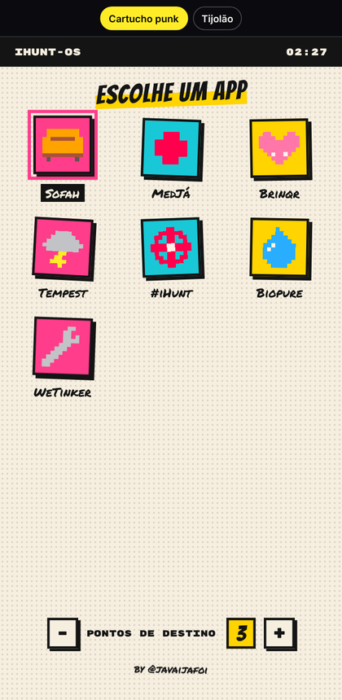
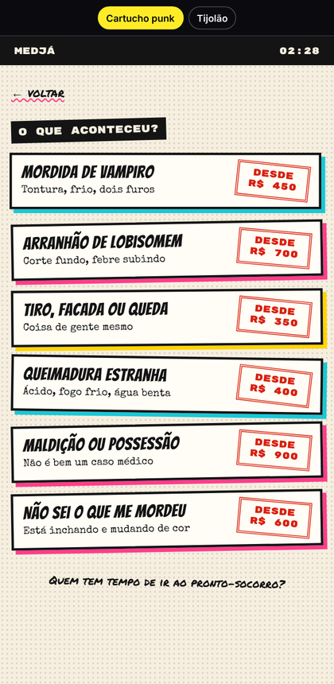
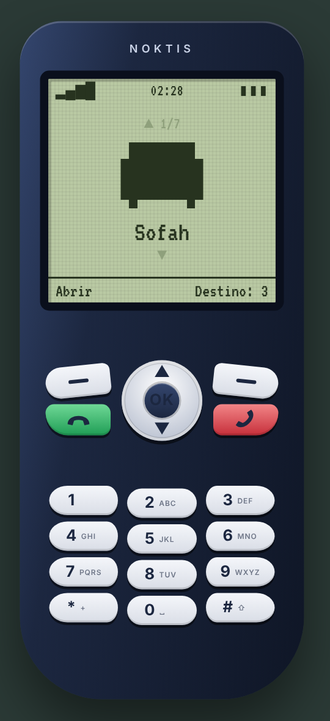

<div align="center">

# 📱 iFone

**O celular de mentira do mundo de #iHunt, para sortear coisas na mesa de RPG.**

O jogador "tira o celular do bolso", abre um app e ele sorteia um resultado:
um sofá para dormir, um médico que não faz perguntas, um contrato de caça.

[](https://ifone-javaijafoi.vercel.app)


-ffd400?style=flat-square&labelColor=111)


 &nbsp;
 &nbsp;


</div>

## 🎲 Como funciona

Cada app é uma tabela de sorteio com cara de aplicativo. Você escolhe o app, o iFone rola e mostra o resultado na hora, com direito a "sortear de novo" e "guardar" (fica salvo só no seu aparelho).

| App | Para que serve na mesa |
| --- | --- |
| 🛋️ **Sofah** | Achar um lugar para dormir |
| ➕ **MedJá** | Um médico que não faz perguntas (e quanto custa) |
| 💘 **Brinqr** | Encontros e contatos |
| ⛈️ **Tempest** | O tempo lá fora |
| 🎯 **#iHunt** | Contratos de caça |
| 💧 **Biopure** | Sangue e afins |
| 🔧 **WeTinker** | Gambiarras e consertos |

Os **pontos de destino** da mesa ficam na tela, para ajustar sem sair do app.

## 🎨 Dois estilos

- **Cartucho punk**: grade de apps em papel e tinta, com ícones em pixel art.
- **Tijolão**: celular antigo de tela verde, com teclado que funciona.

No computador aparece o aparelho inteiro. No celular fica só a tela.

## 🚀 Rodando

É um site estático, sem build. Abra o `index.html` ou sirva a pasta:

```sh
npx serve .
```

Funciona offline depois da primeira visita e pode ser instalado como app (PWA): é só usar "Adicionar à tela inicial" no navegador.

## 🧱 Tecnologias

HTML, CSS e JavaScript puros, service worker para o modo offline e `localStorage` para guardar os resultados salvos.

---

Projeto de fã, sem vínculo com os autores de #iHunt.
Feito por [@javaijafoi](https://github.com/javaijafoi) · parte do [portfólio](https://fantasy-portfolio-zeta.vercel.app).
